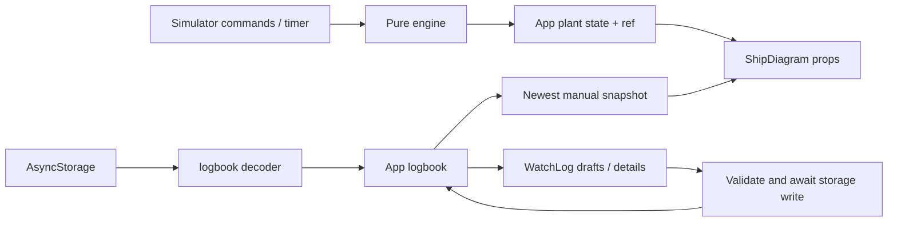

# Implementation map

This describes the version 0.4.0 rebuild in this repository. Start with [STATUS.md](STATUS.md), [TASKS.md](TASKS.md) and [../AGENTS.md](../AGENTS.md) for the current checkpoint and contribution rules. Historical feature descriptions do not establish current behavior. [MODEL.md](MODEL.md) explains the training assumptions; [DATA.md](DATA.md) defines the manual log contract.

## Code map

| File | Responsibility |
| --- | --- |
| `index.ts` | Registers the Expo root component. |
| `App.tsx` | Owns simulator state, manual logbook, storage readiness, mode/navigation, settings and simulation timer. |
| `src/engine/lng.ts` | Pure TypeScript inventory model, commands, validation and derived metrics; no React or storage dependency. |
| `src/components/ShipDiagram.tsx` | Controlled diagram: supplied readings/equipment plus callbacks; local fit/zoom/pan state. |
| `src/components/WatchLog.tsx` | New-observation drafts, history/detail modal, edit drafts, backup merge and export UI. |
| `src/storage/logbook.ts` | Reading metadata, parsers, version-one decoder, immutable add/update helpers and CSV serialization. |
| `src/storage/exportFile.ts` | Browser download or native cache-file/system-share delivery. |
| `tests/engine.test.ts`, `tests/logbook.test.ts` | Node tests of the pure model and data contract. |
| `scripts/verify-browser.mjs` | Browser workflows against the exported web application. |
| `app.json`, `package.json`, `package-lock.json` | Expo/native configuration, commands and locked dependencies. |
| `scripts/build-android.sh`, `.github/workflows/` | Build/check automation; native output is generated, not hand-maintained source. |

## State and data flow

`App` keeps two independent domains: an in-memory `PlantState`, and `{version:1, entries}` persisted at `belem-lng.logbook.v1`. There is no backend, vessel/IAS connection, authentication layer or cross-device synchronization. Simulator state is recreated on app startup; JSON backups contain observations only.

`plantRef.current` is updated alongside React state so timer callbacks use the latest committed plant. “Run 10×” advances ten simulation seconds per one-second JavaScript interval; it is not elapsed-wall-clock catch-up. A manual step advances 60 seconds. Navigation and mode changes pause running; simulation errors also stop it. The interval is cleaned up when running stops or manual mode is selected.

Manual mode selects only `book.entries[0]`, sorted by observation time. Its common fields supply volume, tank pressure, buffer pressure, delivery flow and LNG temperature. Tank pressure is converted from stored mbar(g) to diagram bar(g). Missing readings stay `undefined` and display as unknown; earlier records and simulator values never fill gaps. Custom instrument tags do not map to diagram equipment or readouts.

Manual mode disables training controls and shows equipment as “NOT RECORDED”; equipment flags and ESD state are not observation fields. Switching modes retains the existing simulator in memory. Watch-log operations are available in either mode and never seed or change the simulator.

`ShipDiagram` uses core React Native `View`/`Text`, with a logical 1280×800 canvas scaled to fit. Zoom ranges from fit (1×) to 6× with nested scroll views for panning; a viewport resize resets fit and offsets. It owns no inventory or observation state. This avoids the former SVG text implementation path; it does not establish device performance.

`WatchLog` receives a book and async `onSave` callback. `App.saveBook` validates the proposed book, awaits `AsyncStorage.setItem`, then replaces React state. Failed writes leave the current book unchanged. Drafts, modal selection, pagination and success/error text belong to the watch component; leaving the screen unmounts it and discards those drafts. See [DATA.md](DATA.md) for save/import failure recovery.

## Engine API and units

| Export | Contract |
| --- | --- |
| `createPlant()` / `resetPlant()` | Fresh default inventory/ledger, equipment stopped, ESD clear. `resetPlant` is an alias. |
| `commandPlant(previous, command)` | Returns a detached state for `toggle`, `esd`, `reset-esd` or partial `settings`; throws on unsupported/invalid commands. |
| `advancePlant(previous, seconds)` | Returns a detached state after a finite interval `>0` and `≤86400`; uses substeps of at most one second. |
| `metrics(state)` | Derives tank liquid volume, tank/buffer gauge pressure, liquid/tank-gas/total mass, mass residual and delivered flow. |
| `equipmentKeys`, exported types | Shared equipment identifiers and `PlantConfig`, `PlantState`, `PlantFlows`, `PlantCommand`, `EquipmentKey`. |

All masses and ledger totals use kg, volume uses m³, temperature uses °C and elapsed time uses seconds. `PlantFlows` and `metrics().deliveredKgh` use kg/h. Gauge pressures use bar(g); the ideal-gas calculation converts to Pa absolute internally. Pressure does not use the manual field's mbar(g) unit.

Configuration validation is inclusive at both bounds. These are supported training input ranges, not vessel limits:

| Config key | Unit | Range |
| --- | --- | --- |
| `capacityM3` | m³ | 1–100000 |
| `densityKgM3` | kg/m³ | 300–600 |
| `heatIngressKw` | kW | 0–10000 |
| `demandKgh`, `compressorKgh`, `ventKgh` | kg/h | 0–100000 |
| `pumpFlowM3h`, `bunkerFlowM3h` | m³/h | 0–10000 |
| `liquidTemperatureC` | °C | −170 to −120 |
| `bufferVolumeM3` | m³ | 0.01–1000 |
| `consumerMinimumBarg`, `pumpDischargeBarg`, `compressorDischargeBarg` | bar(g) | 0–50 |

The current settings UI exposes only heat ingress, demand, pump flow and bunker flow; the engine supports the full config above. Settings preserve masses and ledger totals but can change pressures/derived volume; updates reject insufficient ullage. They are model reconfiguration, not a physical process. `PlantState` is an internal trusted structure: there is no general decoder for arbitrary imported state.

Each substep performs passive boiloff, then (unless ESD is latched) bunkering, compression, pump/vaporisation, consumption and venting in that order. Compression therefore fills buffer room before supplemental pumping. Flow readouts average the entire requested interval. Commands clear those readouts until another step. Events are newest-first strings, capped at 120; their displayed seconds are rounded.

ESD immediately clears all equipment flags, including bunkering/vent. Boiloff continues while latched. Reset clears the latch without restarting equipment. The mass residual is `inventory − initial − bunkered + consumed + vented`. These policies and numerical bounds are training behavior; consult [MODEL.md](MODEL.md) before extending them.

## Extension seams and limits

- Keep numerical work in the pure engine and add independent conservation/behavior checks in `tests/engine.test.ts`. Do not couple manual entries to model defaults or add persistence by serializing unvalidated plant state.
- Add common manual readings through `readingFields`; its union drives types, forms, validation, detail display and CSV columns. The diagram projection in `App` still needs explicit mapping. Schema changes require deliberate backward compatibility; no migration framework exists.
- Diagram equipment identifiers are declared separately from engine identifiers. Changes require updating their types, callbacks, geometry and tests together. Current routes are a simplified mimic, with no source-backed instrument register or complete piping topology.
- Preserve the await-before-commit storage boundary and ID-based full-snapshot edits. There is no write queue, revision conflict detection, deletion UI, retention policy or audit history. Adding concurrent writers or sync requires a separate design.
- Use `deliverFile` for actual file delivery. Native sharing and persistence need device checks; source/browser tests cannot establish Android runtime behavior. Build and device instructions live in [ANDROID.md](ANDROID.md).
- The model omits mixture equilibrium, changing temperatures, full energy balance, real equipment curves and ship protective logic. Original references, source provenance and validation remain prerequisites for vessel-fidelity claims.

Run the repository checks documented in [../README.md](../README.md) and record results against the exact commit. Current verification evidence and remaining native/reference blockers belong in STATUS/TASKS, rather than being inferred from this architecture description.
